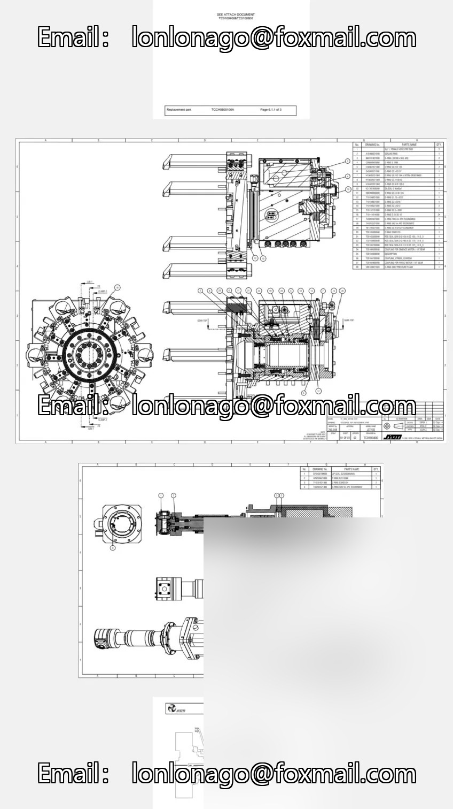
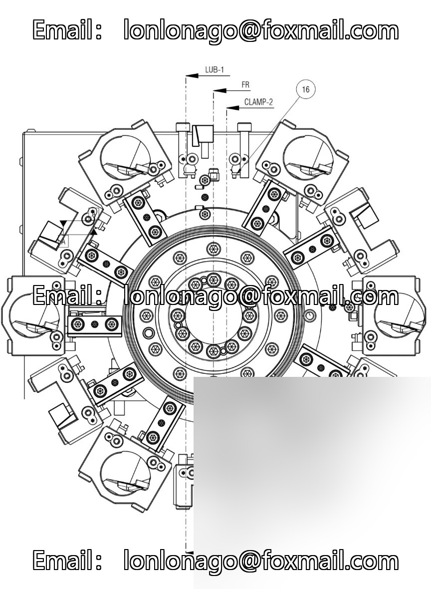
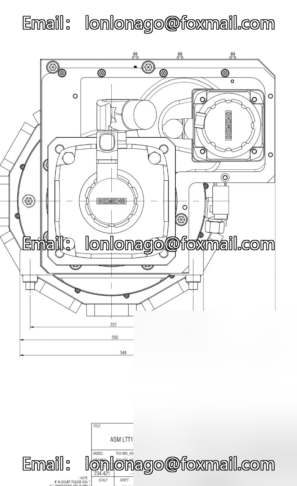
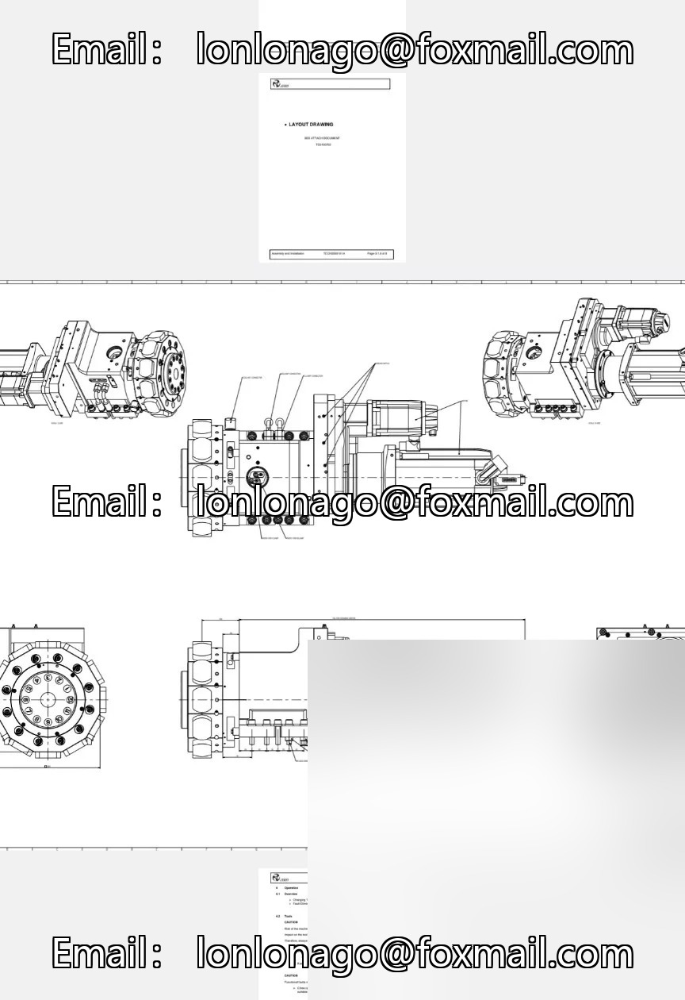
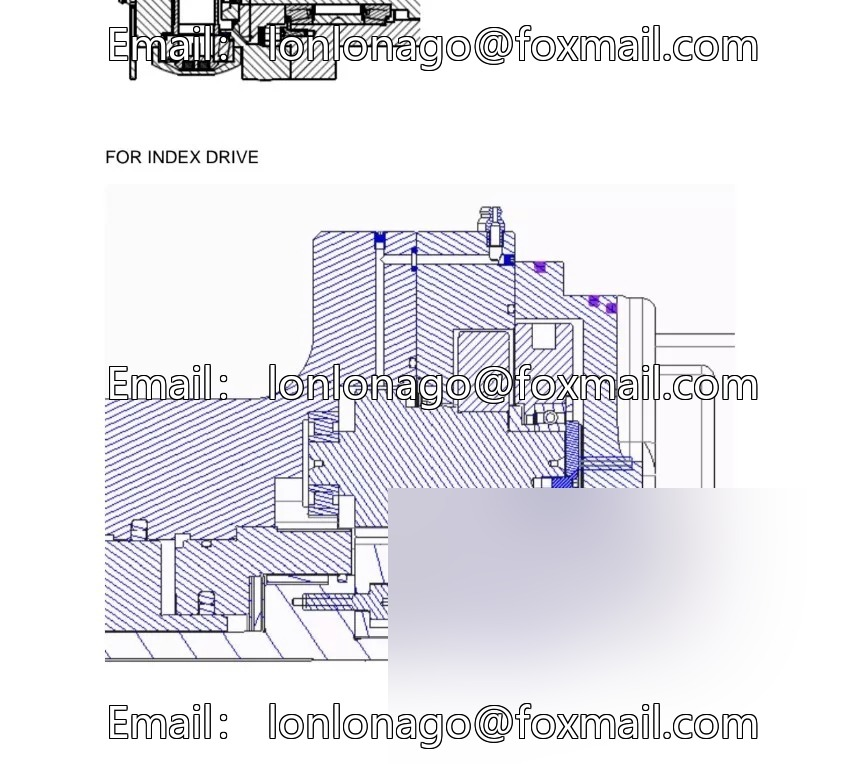
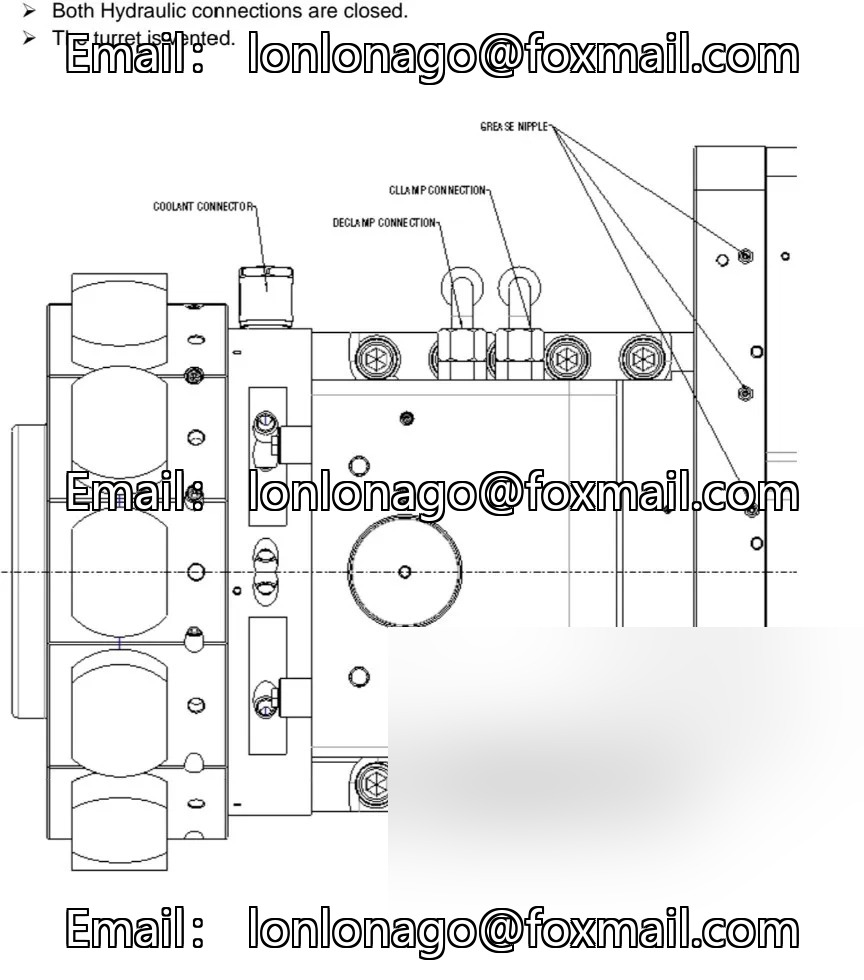

# JYOTI AUTOMATION LTD. company LIVE TU

## Body

JYOTI AUTOMATION LTD. Company Live Turret (Power Turret) Technology Manual PDF file, 35 pages
This equipment is produced by JYOTI AUTOMATION LTD. (Indian Jyoti CNC Automation Co., Ltd.) as a Live Turret — a servo-driven power turret, which is often referred to as a compound vehicle milling turret, and is the core executing component for high-end CNC CNC lathe to achieve one-stop processing of "milling, lathe turning, drilling, and indexing".

upon sale; direct photography required, contact privately for any issues.
7132

The manual covers JYOTI AUTOMATION LTD. Company Live TU and turret technology, providing a 35-page PDF; visible information includes device identifiers, parameters, drawings and operational notes.

<!-- AI_ENRICHED -->

## Images

## Payment

Here is a pay link on Stripe ( https://buy.stripe.com/3cs8yP7sY87d0vu9AB ). Please contact me lonlonago@foxmail.com after funding $89, and I will send you a complete data files , thank you!

